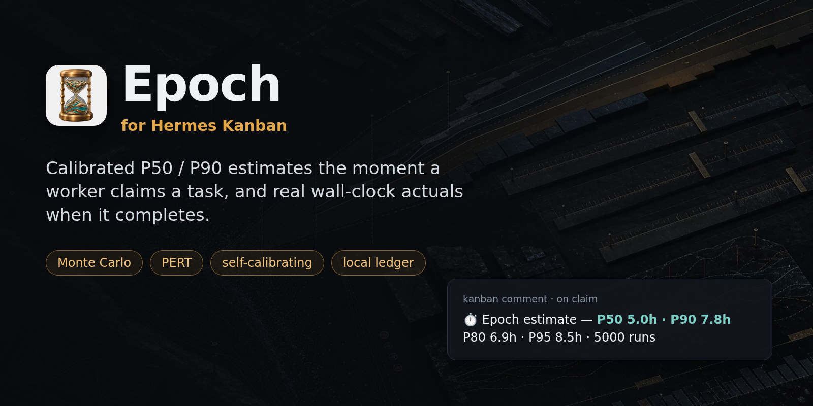
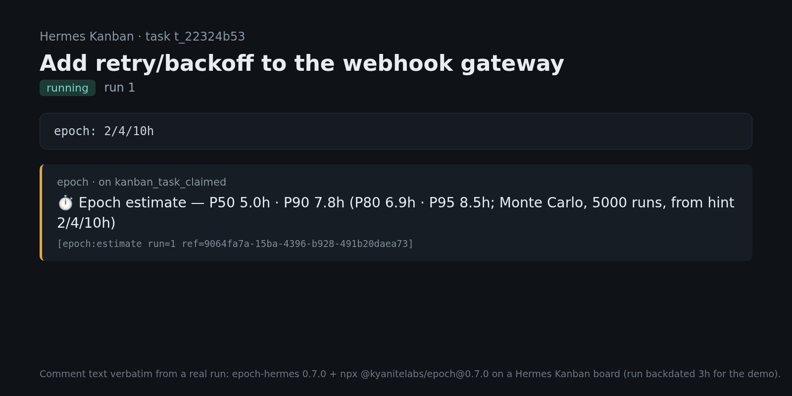
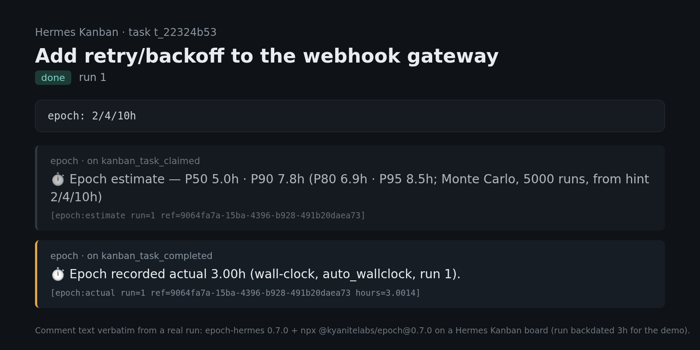
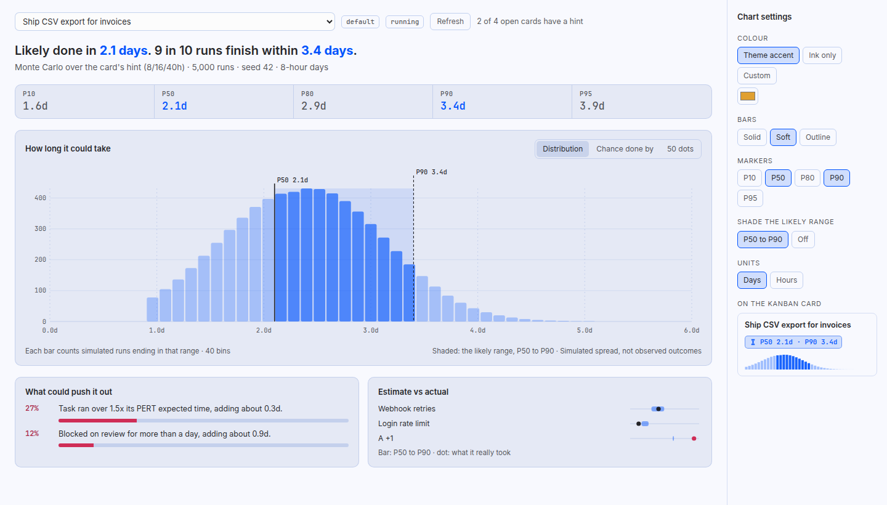

# Epoch for Hermes (native plugin)

P50/P90 estimates on your Hermes Kanban board, calibrated against the actuals you record. They are forecasts, not commitments.



> **Disclosure.** This plugin shells out to `npx -y @kyanitelabs/epoch@0.8.0` (downloads Epoch
> from npm on first run; needs **Node >= 22** and `npx` on `PATH`). The child process gets a
> **scrubbed environment**: only allow-listed `PATH`/`HOME`/locale/temp, Node/npm (cache,
> registry, CA certs) and proxy variables. Your parent environment, API keys and Hermes secrets
> are never passed through. The ledger and run bindings live under
> `<HERMES_HOME>/plugin-data/epoch/` (the root Hermes home, shared by every profile) unless you set
> `epoch_data_dir`. Epoch telemetry is **forced off** for every plugin run (`EPOCH_TELEMETRY=0`,
> which overrides `epoch telemetry enable`). Apart from the npm download there is no network
> access, and no API key. The task title (first 80 chars) and its `epoch:` hint go only to the
> local CLI. Hook work runs on a short-lived background thread.

| Surface | What it does |
|---|---|
| `kanban_task_claimed` hook | Estimates the task and posts a comment. An `epoch: 2/4/10h` line (optimistic/most-likely/pessimistic in hours; `min`, `d` = 8h days and `w` = 5-day weeks also work, any other unit such as sprints is refused) in the title or body gives a Monte Carlo P50/P90 (plus P80/P95); otherwise a reference-class point estimate. A malformed or out-of-order hint is named in the comment and ignored, never silently dropped. Runs in the background, never delays worker spawn. |
| `kanban_task_completed` hook | Records that run's wall-clock hours (`run.ended_at - run.started_at`) against the run's own Epoch `feedbackRef` with `calibration_provenance: auto_wallclock`, so Epoch's wall-clock sanity gate (0.05–12h, <10× the estimate) applies. Rejected actuals are explained on the card. |
| `/epoch <subcommand> [flags]` | Epoch CLI subcommands, e.g. `/epoch pert-estimate --optimistic 2 --most-likely 4 --pessimistic 10`. `serve`, `self-improve`, `share-data`, any `--output` path and telemetry/data mutations are refused (only `telemetry status`, `data where` and `data status` run). Ledger writes (`record-actual`, `batch-record-actuals`, `auto-actuals`, `mine-git`, `calibrate-estimates`) are refused on gateway platforms (Telegram, Discord, …) unless `allow_write_slash_on_gateway: true`. Estimate commands still append their estimate to the local ledger from any platform; that is how a later actual finds it. |
| `epoch_estimate` tool | Agent-callable estimate. Explicit `optimistic`/`most_likely`/`pessimistic` hours (all three, `0 < o <= m <= p`) override any text hint; invalid values are rejected. |

## Install

```bash
hermes plugins install KyaniteLabs/Epoch/plugins/epoch-hermes   # or symlink into ~/.hermes/plugins/epoch
hermes plugins enable epoch
```

Enable it in every profile that runs a Kanban dispatcher or worker. Requires Hermes >= 0.21.6,
Node >= 22 and `npx` on PATH. No API key or secret. The first claim may take a few seconds while
`npx` downloads Epoch; an npm `min-release-age` policy can block the pinned version until it ages
(the job stays in the outbox and retries). Settings (all optional) under `plugins.entries.epoch.settings` in
`config.yaml`:

| Setting | Default | |
|---|---|---|
| `epoch_command` | `npx -y @kyanitelabs/epoch@0.8.0` | Set to `epoch` if installed globally. |
| `epoch_data_dir` | unset → `<HERMES_HOME>/plugin-data/epoch` | Epoch ledger + run bindings (passed as `EPOCH_DATA_DIR`). The default resolves to the root Hermes home even under `profiles/<name>`, so dispatcher and worker share it. Set `~/.epoch` to reuse a standalone Epoch ledger. An `EPOCH_DATA_DIR` env var is honored when this is unset. |
| `comment_on_claim` | `true` | Post the estimate comment. |
| `record_actuals` | `true` | Record wall-clock actuals on completion. |
| `iterations` | `5000` | Monte Carlo iterations. |
| `timeout_seconds` | `60` | Per Epoch CLI call. |
| `shutdown_wait_seconds` | `20` | How long an exiting process waits for in-flight Epoch work. |
| `allow_write_slash_on_gateway` | `false` | Allow `/epoch` ledger-writing commands from gateway platforms. |

## What it looks like

On claim, an estimate lands on the card:



On completion, that run's wall-clock actual is recorded back to the ledger:



These are renders of verbatim comment text from a real run (epoch-hermes 0.7.0 plus
`npx @kyanitelabs/epoch@0.7.0` on a Hermes Kanban board).

### Desktop pane

Hermes Desktop gets an **Epoch** page (sidebar: Epoch). Pick an open Kanban card with an
`epoch: o/m/p` hint and it draws the Monte Carlo spread: a histogram, a "chance done by" curve or
50 equally likely outcomes, with P10–P95 markers, the P50–P90 likely range, the risks that could
push it out, and estimate-vs-actual from your ledger. Chart settings (colour, bar style, markers,
units) stay with you. Cards that already have an estimate show a `P50 · P90` badge on the board.



That render uses sample data. Viewing a chart never writes the ledger: each forecast runs in a
throwaway data dir with a fixed seed, so the same hint always draws the same chart. The full
spread needs Epoch 0.8 or later; older Epochs show the percentiles only.

The page's backend lives in the plugin on the Hermes host (`/api/plugins/epoch/*`). The page itself
loads from `~/.hermes/desktop-plugins/epoch-hermes/plugin.js` (the folder takes the plugin's install name) on the machine running Desktop. When Desktop
connects to a remote Hermes, copy only `desktop/plugin.js` to that path on the Desktop machine; the
plugin, ledger and Epoch CLI stay on the Hermes host.

## How it works

- **Shared bindings, comments for display.** The dispatcher (claim) and the assignee's worker
  (complete) usually run in different profiles, and plugin state is per profile. The authoritative
  `run → feedbackRef` binding is written next to the ledger (default
  `<HERMES_HOME>/plugin-data/epoch/`, which every profile resolves to). Kanban comments still show
  `[epoch:estimate run=<run_id> ref=<feedbackRef>]` for humans, but forged or quoted markers are
  never trusted for recording. A late result from a reclaimed run is dropped, because the plugin
  re-checks that the claim still owns the task before it posts. Comment delivery is tracked
  separately from the ledger `recorded` flag and is claimed under the same bindings flock, so
  concurrent success/duplicate recorders and concurrent claim racers cannot double-post the audit
  comment. A crash after the board accepts the comment but before the local delivery flag flips
  can still retry (at-least-once for that crash window only); calibration data is never duplicated.
- **Either event order.** If a task finishes before its estimate is ready (a short task, or a
  slow first `npx`), the claim side records the actual after it stores the binding. Epoch accepts
  one actual per estimate, and the bindings store marks the run recorded, so each run is recorded
  once.
- **Process lifecycle.** Each job goes into a profile-local outbox before it starts. Outbox
  updates take a cross-process lock so concurrent Hermes processes cannot lose an enqueue or
  double-claim a lease. When the process exits, the plugin waits up to `shutdown_wait_seconds`
  for in-flight work. Anything left over (for example, a one-shot CLI that exits or is killed)
  replays the next time the plugin loads in that profile, up to 5 attempts within 7 days.
- **Public Hermes surface only.** Board reads and writes go through `ctx.dispatch_tool`
  (`kanban_show`, `kanban_comment`). Background threads run under `contextvars.copy_context()`,
  so the event's profile settings and state follow the job.

## Tests

Needs `pytest` and `hypothesis` (the binding state-machine property test).

```bash
python -m pytest plugins/epoch-hermes/tests               # unit + fake-Epoch regression tests
HERMES_AGENT_SRC=/path/to/hermes-agent python -m pytest plugins/epoch-hermes/tests   # + real Hermes, separate processes
```

## Privacy

Estimates and actuals live in Epoch's local ledger under `<HERMES_HOME>/plugin-data/epoch/`.
Plugin-driven Epoch runs always have telemetry off (`EPOCH_TELEMETRY=0`). Standalone Epoch
telemetry is opt-in (`epoch telemetry enable`) and the plugin never turns it on. Task text goes
only to the local Epoch CLI, which runs with a scrubbed environment.

The MCP server and skills for Claude/Cursor are in [`../epoch`](../epoch).

## Known issues

- Epoch 0.7.0 did not screen path flags in `/epoch` pass-through. `/epoch share-data --output <path>` or `/epoch community-export --output <path>` could write a local JSON export (anonymized estimate records) to that path, including from gateway platforms. No data left the machine. 0.8.0 refuses `share-data` and any `--output` or `-o` path from `/epoch`.

## License

Apache-2.0. See [LICENSE](LICENSE). Epoch is an independent project by KyaniteLabs and is not endorsed by Nous Research.
